  

  <a href="https://vareshportfolio.vercel.app"><b>Portfolio</b></a> &nbsp;|&nbsp;
  <a href="https://www.linkedin.com/in/vareshnirbhavne"><b>LinkedIn</b></a> &nbsp;|&nbsp;
  <a href="mailto:vareshworks@gmail.com"><b>Email</b></a>

  Open to junior <b>Data Analyst</b> and <b>Marketing Analyst</b> roles anywhere in the UK, or remote. 
  Right to work: UK Graduate visa, December 2026 to December 2028. No employer sponsorship required.

  

## Selected work

Every project below has its limits written down, and the ones built on simulated data say so.

<table>
  <tr>
    <td width="50%"></td>
    <td width="50%"></td>
  </tr>
  <tr>
    <td width="50%"></td>
    <td width="50%"></td>
  </tr>
  <tr>
    <td width="50%"></td>
    <td width="50%"></td>
  </tr>
</table>

## Toolkit

| | |
|---|---|
| **Languages** | Python (pandas, NumPy, scikit-learn), SQL (window functions, CTEs, DuckDB, SQLite, BigQuery) |
| **Analytics** | Excel, Tableau, Google Analytics 4, A/B test design, regression, SPSS |
| **AI and automation** | Local LLMs with Ollama, automatic number checkers for AI-written reports |
| **Marketing** | Meta Ads Manager, Google Ads (Search certified), HubSpot |

## How I work

1. **Start with the business question**, not the dataset.
2. **Check the sample is fair** before trusting the result.
3. **Keep the model simple** when a complex one scores the same.
4. **Test the AI.** My first AI-written monthly summary mixed up customers and revenue, so I built a number checker. It is now part of the pipeline.
5. **Write the limits down.** Accuracy is not the same as usefulness.

## Background

I started in filmmaking and marketing, and the question that kept coming back was *which of it actually worked?* I finished an **MSc Marketing (Merit)** at the University of Birmingham while teaching myself SQL, Python and machine learning on the side. It felt like doing two degrees at once, analytics and marketing, and that is the mix I want to work in.

  <a href="mailto:vareshworks@gmail.com">vareshworks@gmail.com</a>

